 

## About me

I build LLM applications end to end: the retrieval layer, the agent graph, the API around them, and the evaluation that tells me whether any of it works. Most of my work sits where a model meets real data, so I spend my time on the parts that keep it correct.

<table>
  <tr>
    <td width="50%" valign="top">
      <h3>Retrieval-augmented generation</h3>
      Chunking, embeddings and vector search with Qdrant and FAISS, routed so that answers stay grounded in what was actually retrieved.
    </td>
    <td width="50%" valign="top">
      <h3>Agentic workflows</h3>
      LangGraph state machines and MCP tool calling, with Pydantic schemas on every tool call and deterministic code between model steps.
    </td>
  </tr>
  <tr>
    <td width="50%" valign="top">
      <h3>LLM evaluation</h3>
      Cost, latency and output quality measured on my own test cases before I write any integration code.
    </td>
    <td width="50%" valign="top">
      <h3>Backend and cloud</h3>
      FastAPI services, PostgreSQL, MongoDB and Redis, AWS serverless and Docker, designed for retries, races and duplicate deliveries.
    </td>
  </tr>
</table>

## Tech stack

    
    
  

  
  
  
  
  
  
   
  
  
  
  
  
  

## Featured projects

<table>
  <tr>
    <td width="50%" valign="top">
      
      
<a href="https://github.com/MayukhBanerjee/Scheduler-AI"><b>Code</b></a> · <a href="https://scheduler-ai-haha.vercel.app"><b>Live demo</b></a>

    </td>
    <td width="50%" valign="top">
      
      
<a href="https://github.com/MayukhBanerjee/EcoLoop"><b>Code</b></a>

    </td>
  </tr>
  <tr>
    <td width="50%" valign="top">
      
      
<a href="https://github.com/MayukhBanerjee/Evoke"><b>Code</b></a>

    </td>
    <td width="50%" valign="top">
      
      
<a href="https://github.com/MayukhBanerjee/LeBy"><b>Code</b></a>

    </td>
  </tr>
</table>

## How I build

- **The model handles language, code handles correctness.** My agents turn input into typed state and write the reply. Lookups, ranking and constraint checks stay deterministic, so I can test them.
- **Every tool call gets validated.** Pydantic schemas on tool arguments, invariants before anything touches a real system, and a safe fallback when a check fails.
- **Retrieval is debugged one stage at a time.** Chunking, embeddings, the index and ranking are checked separately, so a bad answer can be traced to where it went wrong.
- **I evaluate before I integrate.** Cost, latency and my own test cases come before any integration code.
- **Backends that survive retries.** Unique keys with `ON CONFLICT`, no check-then-insert races, and graceful shutdowns that finish in-flight work.

<b>Failure modes I design for</b>

 

| Failure | What I do about it | Seen in |
|---|---|---|
| The model invents a value that has to be exact | The model only parses and phrases. Lookups, ranking and availability run as plain code over typed state. | [Scheduler AI](https://github.com/MayukhBanerjee/Scheduler-AI) |
| A webhook is delivered twice | `UNIQUE (event_id)` plus `INSERT … ON CONFLICT DO NOTHING`. Zero rows affected means ack and skip. | [Webhook ingest](https://github.com/MayukhBanerjee/Covin-Task) |
| Check-then-insert race (TOCTOU) | One atomic statement instead of `SELECT` then `INSERT`, with a concurrent-duplicate test under `go test -race`. | [Webhook ingest](https://github.com/MayukhBanerjee/Covin-Task) |
| Background work dies with the request | A detached context for the worker, and a `sync.WaitGroup` drained on graceful shutdown. | [Webhook ingest](https://github.com/MayukhBanerjee/Covin-Task) |
| Dedup state splits across two stores | The Postgres unique constraint is the single source of truth. Redis `SET NX` was rejected: if it succeeds and the insert fails, the retry is wrongly dropped as a duplicate. | [Webhook ingest](https://github.com/MayukhBanerjee/Covin-Task) |
| An agent proposes an unsafe setpoint | Pydantic-validated tool arguments, then a clamp layer of invariants. If a check fails, hold the last safe action. | [EcoLoop](https://github.com/MayukhBanerjee/EcoLoop) |
| A persona states opinions the person never held | Schema-conditioned RAG and a humility gate that declines instead of inventing. | [Evoke](https://github.com/MayukhBanerjee/Evoke) |
| Document context leaks into general chat | A mode router: document questions hit FAISS, general ones never touch the vector store. | [LeBy](https://github.com/MayukhBanerjee/LeBy) |
| Every classification pays for an LLM call | TF-IDF and logistic regression give a fast verdict first. The LLM adds reasoning second. | [Fake news detector](https://github.com/MayukhBanerjee/Fake-News-Prediction) |

## More projects

| Project | What it is | Stack |
|---|---|---|
| [Webhook ingest](https://github.com/MayukhBanerjee/Covin-Task) | Found and fixed duplicate counting, a TOCTOU race, a data race and lost background work in a Go service, then made ingestion idempotent. | Go, PostgreSQL, Docker |
| [Coldmailer](https://github.com/MayukhBanerjee/Coldmailer) | A LangGraph email pipeline with a critic node that scores weak drafts and rewrites them. | LangGraph, Groq, Streamlit |
| [Campus RAG assistant](https://github.com/MayukhBanerjee/VIT-Student-Helper-RAG-KB) | A RAG assistant over a custom PDF knowledge base, served through a REST API. | Qdrant, Gemini, LangChain, FastAPI |
| [Fake news detector](https://github.com/MayukhBanerjee/Fake-News-Prediction) | Two-stage check: a fast TF-IDF classifier, then an LLM that explains its verdict. | scikit-learn, Gemini, FastAPI |
| [Smog in the Prompt](https://github.com/MayukhBanerjee/Smog-in-the-Prompt) | Do LLMs reflect real Delhi pollution data, or what people say about it online? | NLP, Pandas, LLM evaluation |
| [Portfolio](https://github.com/MayukhBanerjee/MyPortfolio) | My site, with a trigram language model written from scratch and trained on its own text. | Next.js, GSAP, three.js |

## GitHub activity

  <picture>
    <source media="(prefers-color-scheme: dark)" srcset="https://streak-stats.demolab.com/?user=MayukhBanerjee&theme=dark&hide_border=true&background=0D1117&ring=00D4B4&fire=00D4B4&currStreakLabel=00D4B4&sideLabels=C9D1D9&dates=8B949E" />
    
  </picture>

## Let's connect

If you're building with LLMs, retrieval or agents, I'd like to hear about it: **[mayukhbanerjee011@gmail.com](mailto:mayukhbanerjee011@gmail.com)**

  

