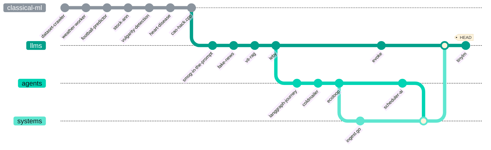
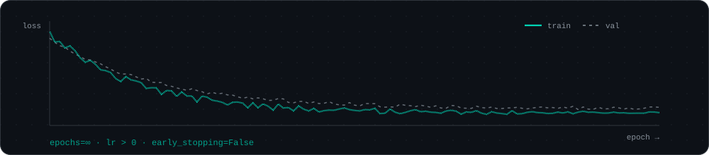

<div align="center">
  
</div>

<br/>

```yaml
# model card
model_id:      mayukh-banerjee
model_type:    ai/ml engineer
base_model:    b.tech information technology, vit (2023 → 2027)
location:      bangalore · utc+05:30
pipeline_tag:  retrieval-augmented-generation
languages:     [python, typescript, javascript, go, java, c++]
tags:
  - agents          # langgraph state machines, mcp tool calling, typed state
  - retrieval       # qdrant, faiss, chroma, pinecone, hybrid tf-idf + dense
  - llm-evaluation  # my own test cases before any integration code
  - inference-cost  # batching, caching, fewer model calls per request
  - backend         # fastapi, node, postgres, mongodb, redis, aws serverless
providers:     [openai, anthropic, bedrock, gemini, groq, xai, huggingface]
ml:            [pytorch, keras, scikit-learn, xgboost]
status:        open to full-time ai/ml roles
```


## 01 · architecture



Most of my agents look like this. The model turns language into a typed object and a typed object back into language. Everything between is code I can test: indexed lookups, scoring, constraint checks. If the model can't produce a field, the graph asks for it instead of guessing.

```python
async def handle(message: str, state: AgentState) -> Reply:
    intent = await llm.parse(message, schema=Intent)          # model: language in
    if missing := intent.missing_fields():
        return Reply.clarify(missing)                         # code: ask, don't guess
    candidates = await index.search(intent.tags)              # code: indexed query
    ranked = rank(candidates, intent.preferences)             # code: deterministic score
    verified = [c for c in ranked if c.slot in free_slots(c)] # code: hard constraint
    return await llm.write(verified, tone=state.tone)         # model: language out
```


## 02 · retrieval




## 03 · failure modes I design for

| failure | what I do about it | seen in |
|---|---|---|
| model invents a value that has to be exact | model only parses and phrases. lookups, ranking and availability run as plain code over typed state | [Scheduler-AI](https://github.com/MayukhBanerjee/Scheduler-AI) |
| webhook delivered twice (at-least-once) | `UNIQUE (event_id)` + `INSERT … ON CONFLICT DO NOTHING`. 0 rows affected ⇒ ack and skip | [Covin-Task](https://github.com/MayukhBanerjee/Covin-Task) |
| check-then-insert race (TOCTOU) | one atomic statement instead of `SELECT` then `INSERT`, plus a concurrent-duplicate test under `go test -race` | [Covin-Task](https://github.com/MayukhBanerjee/Covin-Task) |
| background job dies with the request context | detached context for the worker, `sync.WaitGroup` drained on graceful shutdown | [Covin-Task](https://github.com/MayukhBanerjee/Covin-Task) |
| agent proposes an unsafe actuator value | tool args validated by Pydantic, then a clamp layer of invariants. on failure, hold the last safe action | [EcoLoop](https://github.com/MayukhBanerjee/EcoLoop) |
| generated persona states opinions the person never held | schema-conditioned RAG and a humility gate that declines instead of inventing | [Evoke](https://github.com/MayukhBanerjee/Evoke) |
| document context leaks into general chat | mode router: document mode hits FAISS, general mode never touches the vector store | [LeBy](https://github.com/MayukhBanerjee/LeBy) |
| every classification pays for an LLM call | TF-IDF + logistic regression first for a fast verdict and confidence, the LLM second for reasoning | [Fake-News-Prediction](https://github.com/MayukhBanerjee/Fake-News-Prediction) |
| weak draft ships because nothing checks it | a critic node in the graph scores drafts and rewrites the weak ones before output | [Coldmailer](https://github.com/MayukhBanerjee/Coldmailer) |


## 04 · training data



I learned it in this order on purpose. When a RAG answer goes wrong, I want to know whether it's the chunking, the embedding, the index, the ranking or the prompt, and that's hard to see if you started at the top.


## 05 · commit history




## 06 · known limitations

- **high time-to-first-token.** Before I write integration code for an API, I check its cost, latency and how it does on my own test cases. Slower start, fewer surprises later.
- **still training on** production backend and system design. A pipeline that handles its data badly falls over long before the model becomes the problem.
- **context window:** one deep problem at a time.
- **generalises past the spec.** Sometimes I end up solving a problem that wasn't in the requirements doc.


## 07 · telemetry

<div align="center">

<picture>
  <source media="(prefers-color-scheme: dark)" srcset="https://streak-stats.demolab.com/?user=MayukhBanerjee&theme=dark&hide_border=true&background=0D1117&ring=00D4B4&fire=00D4B4&currStreakLabel=00D4B4&sideLabels=C9D1D9&dates=8B949E" />
  
</picture>

</div>


## 08 · inference

<div align="center">

<a href="https://mayukh-banerjee.vercel.app"></a>
<a href="https://www.linkedin.com/in/mayukh-banerjee"></a>
<a href="mailto:mayukhbanerjee011@gmail.com"></a>


If you've got a problem nobody's put into words yet, I'd like to hear about it.



</div>
